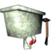

<div align="center">

# Dialoggo



A retro dialogue scene editor inspired by Banjo-Kazooie and Banjo-Tooie.

[](https://github.com/ponkis/dialoggo/actions/workflows/ci.yml)
[](https://github.com/ponkis/dialoggo/releases/latest)
[](LICENSE)


</div>

Choose a character and backdrop, write a line, then preview it with animated sprites and voice clips.

## Features

- Write and format dialogue with emphasis, italics, and strikethrough.
- Choose animated characters and scene backgrounds from the included packs.
- Preview speech playback with character-specific voice clips and playback controls.
- Keep favorites close at hand, and hide characters or backgrounds you don't use.
- Adjust the scene with mirror and low-resolution N64-style display modes.
- Drive playback from the keyboard, with an optional on-screen shortcut visualizer.
- Stay current with a built-in update checker that downloads and installs new releases.

## Download

Installers for Windows, macOS, and Linux are attached to each [GitHub release](https://github.com/ponkis/dialoggo/releases). Every release includes a `SHA256SUMS.txt` file for verifying downloads. Once installed, Dialoggo checks for new releases at startup (you can turn this off in **Settings → Updates**) and can download and install them for you. Builds are not code-signed yet, so Windows SmartScreen and macOS Gatekeeper may ask for confirmation the first time you open the app.

## Run from source

Requires Node.js 22.12 or newer.

```bash
git clone https://github.com/ponkis/dialoggo.git
cd dialoggo
npm ci
npm start
```

`npm start` runs a **Development** build (`Dialoggo Development`), which keeps its settings and logs separate from an installed copy of Dialoggo. Press <kbd>Ctrl</kbd>+<kbd>Shift</kbd>+<kbd>I</kbd> for DevTools and <kbd>Ctrl</kbd>+<kbd>Shift</kbd>+<kbd>R</kbd> to reload.

## Commands

| Command | Purpose |
| --- | --- |
| `npm start` | Build development bundles and launch the app. |
| `npm run lint` | Lint the codebase with ESLint. |
| `npm test` | Run unit and integration tests. |
| `npm run test:smoke` | Launch the built app and check that it starts cleanly. |
| `npm run build` | Build the production app into `dist/`. |
| `npm run package` | Build installers for the current OS into `release/`. |
| `npm run package:dev` | Build a side-by-side "Dialoggo Development" installer. |
| `npm run verify` | Lint, validate, test, build, and audit licenses (what CI runs). |
| `npm run promote` | Merge `dev` into `main` and push. |
| `npm run promote:release` | Promote and tag `v<version>` to publish a release. |

## Branches and releases

```text
work on dev -> CI + dev builds -> npm run promote:release -> vX.Y.Z tag on main -> GitHub Release
```

- **`dev`** is where work happens. Every push runs CI, and pushes to `dev` also produce downloadable development builds as workflow artifacts.
- **`main`** only receives merges from `dev`. Version tags on `main` trigger the release workflow, which packages Windows, macOS, and Linux builds, writes checksums, and publishes the GitHub release.

See [Release process](docs/RELEASE.md) for the full checklist.

## Architecture

```text
src/
├── main/        Electron main process: lifecycle, window, IPC handlers,
│                dialoggo:// asset protocol, and the asset catalog service
├── preload/     Sandboxed bridge exposing a narrow window.dialoggo API
├── renderer/    UI page: composition root, features (views + controllers),
│                state, services, and pure domain logic
└── shared/      Code used by more than one process (metadata, IPC channels)

public/          Static assets copied into the app: art, sounds, fonts, CSS
build/           Packaging resources (app icon)
scripts/         Build, dev launcher, packaging, smoke test, promotion
test/            Node test runner suites (unit + integration)
```

The renderer runs sandboxed with no Node.js access. It loads from a custom `dialoggo://` protocol, and asset discovery happens in the main process. See [Architecture](docs/ARCHITECTURE.md) for the process model and security boundary.

## Project guides

- [Architecture](docs/ARCHITECTURE.md)
- [Development setup](docs/DEVELOPMENT.md)
- [Release process](docs/RELEASE.md)
- [Smoke test checklist](SMOKE_TEST.md)
- [Contributing](CONTRIBUTING.md)
- [Security reporting](SECURITY.md)
- [Support](SUPPORT.md)
- [Changelog](CHANGELOG.md)

## Licensing and bundled media

The application code is licensed under [MIT](LICENSE). The license covers only the code, not the media bundled with the app.

Dialoggo is an unofficial fan project and is not affiliated with or endorsed by Rare, Microsoft, or Nintendo. Banjo-Kazooie and Banjo-Tooie characters, artwork, audio, and names belong to their respective owners, including Rare Ltd. and Microsoft. Custom characters and backgrounds belong to their own creators and rights holders, and they may come from other works. The project claims no ownership of any bundled asset.

See [NOTICE.md](NOTICE.md) for details, redistribution guidance, and how rights holders can request removal.
