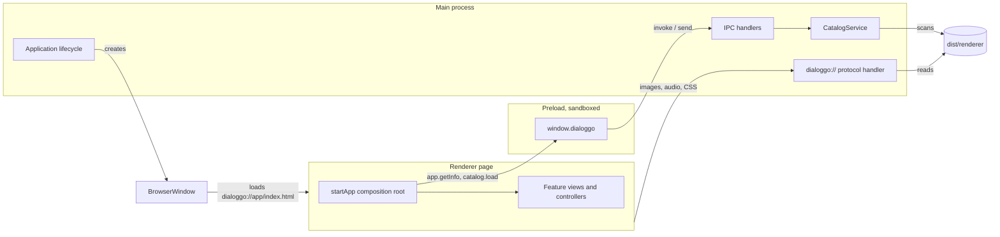

# Architecture

Dialoggo is an Electron desktop app split along Electron's process model. The **main process** owns the operating system, files, and windows. A **sandboxed preload** exposes a small, typed bridge. The **renderer** is an ordinary web page with no Node.js access, organized into feature modules.

## Process flow



## Source layout

| Path | Owns |
| --- | --- |
| `src/main/index.js` | Entry point: environment, scheme privileges, crash reporter, then `Application.start()`. |
| `src/main/Application.js` | Lifecycle: single-instance lock, protocol and IPC registration, main window, smoke-test exits. |
| `src/main/config/` | Build environment (development/production) and runtime paths of the bundled layout. |
| `src/main/protocol/assetProtocol.js` | The privileged `dialoggo://app/` scheme that serves `dist/renderer` with path containment. |
| `src/main/services/catalog/` | Discovers characters, backgrounds, and interface assets and returns them as `dialoggo://` URLs. |
| `src/main/services/updates/` | Checks GitHub releases, downloads and verifies installers, and records the last-run version. |
| `src/main/ipc/` | IPC handlers by area, plus sender validation shared by all of them. |
| `src/main/windows/` | BrowserWindow options, navigation guards, external-link handling, developer shortcuts. |
| `src/main/security/` | URL, JSON, and path validation helpers. |
| `src/preload/index.js` | The `window.dialoggo` bridge: `app`, `catalog`, `window`, and `log`. |
| `src/shared/` | Metadata, the IPC channel registry, and pure helpers used by both sides. |
| `src/renderer/app/startApp.js` | Composition root: builds services, views, and controllers, binds events, restores the session. |
| `src/renderer/features/<feature>/` | One folder per UI area. `*View.js` renders DOM, `*Controller.js` handles input and flow. |
| `src/renderer/state/` | Session state, persisted preferences, and favorites/recent/hidden collections. |
| `src/renderer/services/` | Web Audio playback, the speech sound loop, and the image cache. |
| `src/renderer/domain/` | Pure logic: dialogue markup and wrapping, speech cadence, input formatting, id lists. |
| `src/renderer/core/` | Bridge access, DOM registry, event bus, and timing helpers. |

### Renderer features

| Feature | Responsibility |
| --- | --- |
| `playback` | The dialogue sequence: open, type, scroll, pause/resume/stop, fast forward, close. Owns the control buttons. |
| `dialogue` | The dialogue box, the input with its markup highlight and toolbar, line layout, and N64 text rendering. |
| `characters` | The character reel, card animations, selection, search, favorites, hidden, recents. |
| `backgrounds` | The backgrounds sleeve, pack navigation, selection, favorites, hidden, recents. |
| `stage` | The preview: sprite renderer, background cross-fade, title banner, loading placeholder. |
| `panels` | The flip card and sleeve tabs, plus collapsing the preview for tall panels. |
| `shortcuts` | Keyboard shortcuts and the on-screen visualizer and alerts. |
| `settings` | Settings toggles and restoring them from preferences. |
| `startup` | Boot loading animation, asset prewarm, iris reveal, and the shutdown outro. |
| `updates` | The startup and manual update checks, and the download and install prompts. |
| `contextMenu`, `dialog`, `guide`, `chrome` | Right-click menu, in-app modal dialog, guide screenshot viewer, title bar and global UI sounds. |

## Design rules

- **Explicit dependencies.** Every view and controller is a factory that receives what it uses. Only `startApp.js` knows how the pieces fit together.
- **Views render; controllers decide.** Views own DOM and canvas updates and expose small methods. Controllers handle events, update state, and call views and services.
- **Pure logic stays pure.** Anything testable without a DOM (markup parsing, wrapping, speech cadence, id-list rules) lives in `domain/` or `shared/` and has unit tests.
- **One event, one direction.** The `EventBus` is only for cross-cutting notifications that would otherwise create cycles. Today that is `playback:ui-synced`, which refreshes the shortcut overlay.
- **Persisted keys are a data format.** `PreferencesStore` keys must not be renamed without a migration.

## Security boundary

The BrowserWindow runs with `sandbox: true`, `contextIsolation: true`, and `nodeIntegration: false`. The renderer has no filesystem access:

- Static files load through the `dialoggo://app/` protocol. The handler maps each URL to a file under `dist/renderer`. It rejects traversal, backslashes, NUL bytes, and foreign hosts.
- The asset catalog is built in the main process and returned over IPC as plain data with `dialoggo://` URLs.
- IPC handlers accept messages only from frames served by `dialoggo://app`.
- The Content Security Policy in `src/renderer/index.html` allows only `'self'`, `data:` images, the ponkis logo, and Google Fonts stylesheets. It does not allow `file:`.
- New windows are denied. Only validated `http(s)` links open, and they go to the system browser. Webviews are blocked.

When the UI needs a new privileged capability, add a channel to `src/shared/ipcChannels.js`, a handler under `src/main/ipc/handlers/` that validates the sender and its input, and a narrow method on the preload bridge.

## Updates

The updater follows the same flow as Mystral's:

1. **Check.** At startup (unless turned off in Settings → Updates), or from **Check now**, the main process reads `https://api.github.com/repos/ponkis/dialoggo/releases/latest` and compares its tag with the running version using semver precedence.
2. **Confirm.** If the release is newer, the renderer shows "Update available" with a "What's new?" compare link. Nothing downloads until the user confirms.
3. **Download.** The platform asset (`-win-x64-setup.exe` on Windows, the matching `.dmg` on macOS) streams to the temp folder, with progress, cancel, a stall timeout, and retry on failure. Downloads are only accepted from `https://github.com/ponkis/dialoggo/releases/download/`, and each file must match its entry in the release's `SHA256SUMS.txt`.
4. **Install.** On Windows, the installer is launched and the app closes. On macOS, the disk image opens. Linux, development builds, and unpackaged runs open the release page instead.
5. **After updating.** The main process stores the last-run version in userData. On the first launch of a newer version, the app shows "Update installed" with a link to the changes.

Leftover installers in the temp folder are deleted on the next launch.

## Environments

The build environment is fixed at bundle time through Webpack's `DefinePlugin` (`process.env.DIALOGGO_ENV`):

| | Development | Production |
| --- | --- | --- |
| Produced by | `npm start`, `npm run build:dev`, `npm run package:dev` | `npm run build`, `npm run package` |
| App name / id | `Dialoggo Development` / `xyz.ponkis.dialoggo.dev` | `Dialoggo` / `xyz.ponkis.dialoggo` |
| Version | `X.Y.Z-dev` (CI: `X.Y.Z-dev.<run>`) | `X.Y.Z` |
| Settings and logs | `%APPDATA%/Dialoggo Development` | `%APPDATA%/Dialoggo` |
| DevTools / reload shortcuts | Enabled | Disabled |
| Updates | Check only, then open the release page | Check, download, and install |

## Build pipeline

`scripts/lib/buildPipeline.js` produces the same layout for every build:

```text
dist/
├── package.json          generated, points Electron at main/index.js
├── main/index.js         main process bundle
├── preload/index.js      preload bundle
└── renderer/
    ├── index.html        from src/renderer/index.html
    ├── assets/js/app.js  renderer bundle
    └── ...               everything in public/
```

Production bundles are minified and obfuscated. electron-builder packages `dist/` as-is (`directories.app = dist`), so installers contain no `node_modules`. All npm packages are dev dependencies because Webpack inlines what the app uses.

## Asset and license boundary

Everything in `public/` ships with the app. Review [NOTICE.md](../NOTICE.md) before adding, redistributing, or reusing media. The repository's MIT license covers application code. It does not grant rights to third-party artwork, sounds, fonts, or franchise marks.
